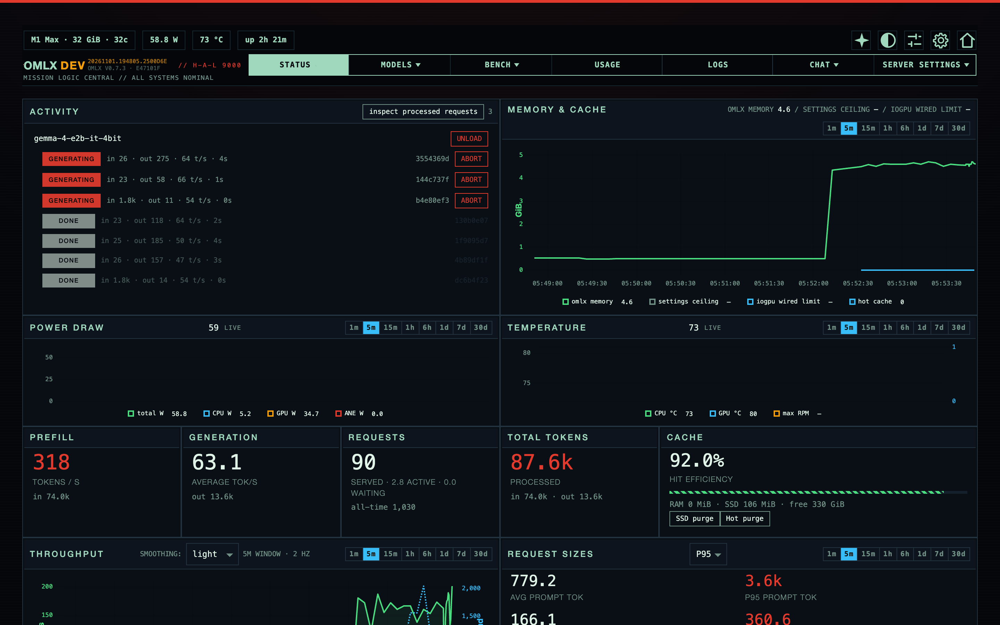
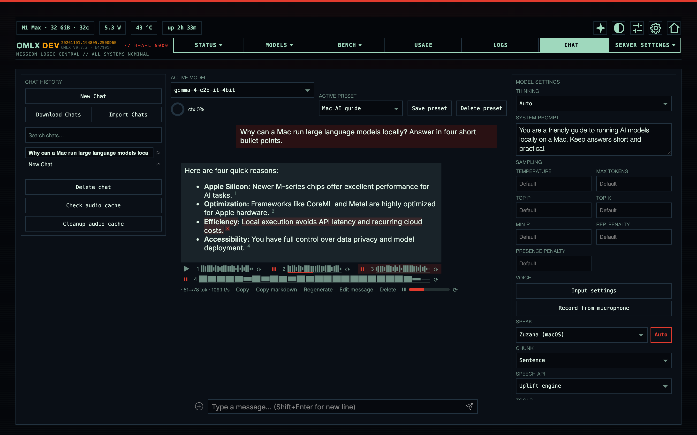
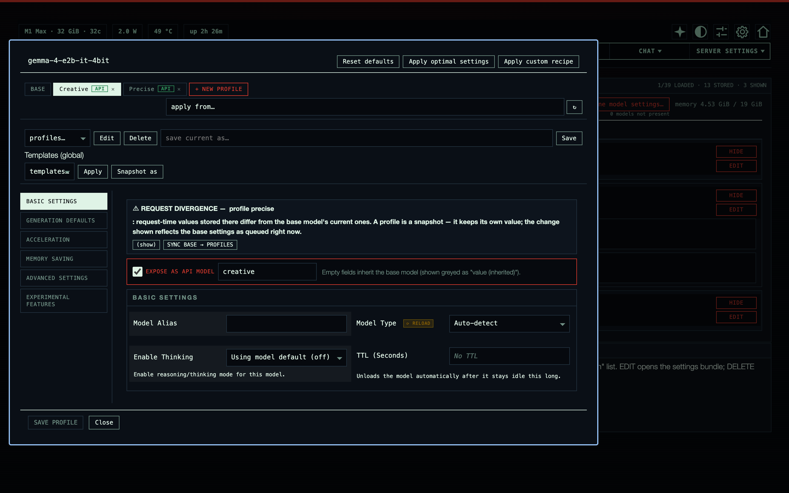
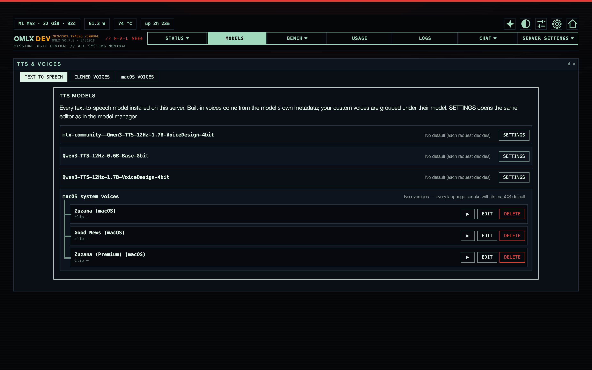
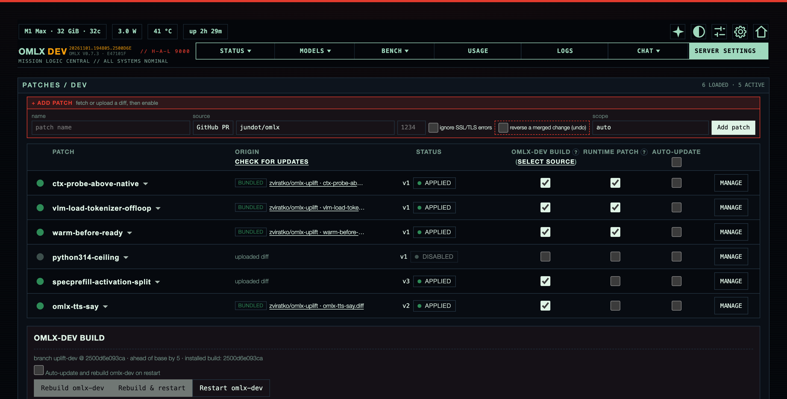
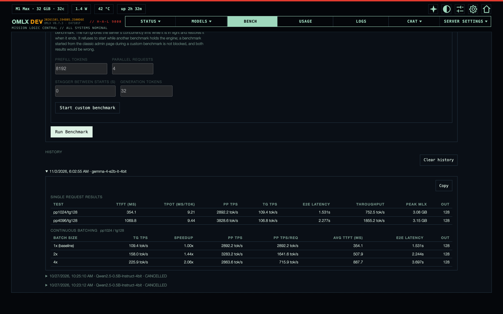
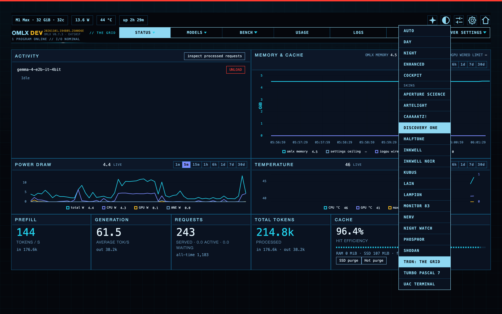
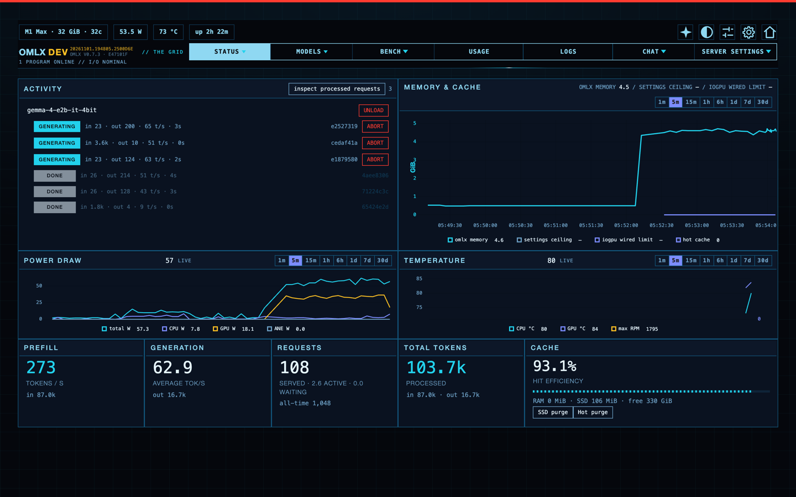
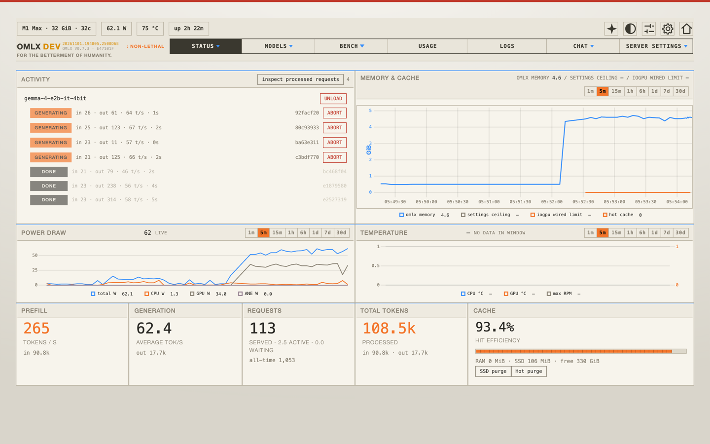
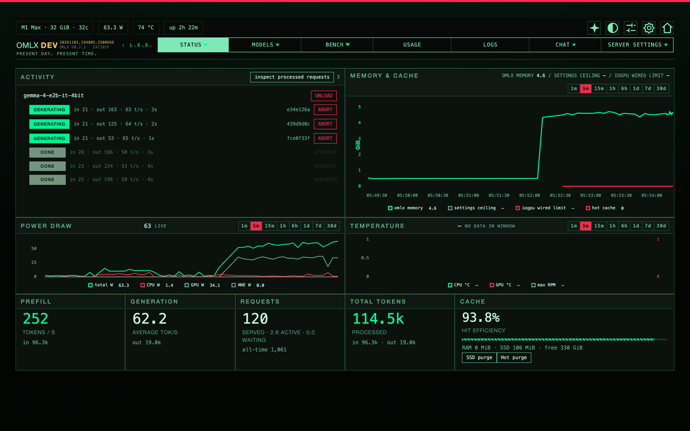

# oMLX Uplift

**A companion dashboard for [oMLX](https://github.com/jundot/omlx), the LLM server for Apple Silicon Macs.**

Uplift installs next to oMLX and adds a live status board, a chat you can talk to, voice cloning, model profiles, a patch manager and dev builds of the newest oMLX. Uplift does not replace anything: the classic admin page stays at `/admin/`, and Uplift lives at `/uplift/`.



*The status board while a small model serves three parallel chats: live requests, power draw, throughput, memory and cache.*

## What you get on top of oMLX

- **Live status board.** Requests as they run, tokens per second, memory, cache hits, power and temperature. Charts keep 30 days of history; drag a range to zoom, click a title to open the graph full size, and arrange the cards the way you like.
- **Chat with voice.** Replies can read themselves aloud while they stream. Talk back with push-to-talk or hands-free listening through a local speech model. Attach files, search and pin conversations, branch from an earlier answer, see the context use of every reply.
- **Presets and profiles.** Save the whole chat setup (prompt, sampling, thinking, web search, voice) as a preset. Give one model several profiles, for example `creative` and `precise`, and call each one as its own model name from any API client.
- **Voices.** Clone a voice from a short clip, or use the macOS system voices. Every client that speaks the OpenAI audio API can use them, for example `Qwen3-TTS:Jake`.
- **Patches.** Run an open oMLX pull request or your own fix today. Every patch is checked before it is stored, keeps its versions, and can be rolled back or switched off. Disabling a patch restores the original oMLX files.
- **Dev builds.** Build oMLX from the newest upstream source plus your patches. Old builds stay installed, so going back takes seconds.
- **Benchmarks.** All oMLX benchmarks, plus embeddings, rerankers, a decision bench, a custom parallel-load test and extra intelligence suites. Runs wait in a queue, and raw results are downloadable.
- **Themes and languages.** 18 bundled skins plus your own (one YAML file each), and 10 UI languages.

## Install

You need an Apple Silicon Mac and [Homebrew](https://brew.sh).

### Option 1: Uplift with the regular oMLX

This is the right choice for most people.

```bash
brew tap jundot/omlx https://github.com/jundot/omlx      # the oMLX formula lives in the app repo (~226 MB clone)
brew tap zviratko/uplift https://github.com/zviratko/omlx-uplift
brew trust jundot/omlx zviratko/uplift                    # Homebrew 7 refuses untrusted third-party taps
brew install omlx omlx-uplift                             # Uplift is not a server, so install both
omlx-uplift install                                       # connects Uplift to oMLX
brew services start omlx
```

Already run oMLX from Homebrew? Skip `omlx` in the `brew install` line and use `brew services restart omlx` at the end.

Then open **http://127.0.0.1:8000/uplift/** in your browser:

1. A new server has no API key yet, so the login page asks you to create one. Do this on the Mac that runs oMLX (key setup works only from `127.0.0.1`).
2. Log in with that key. The same key works for the classic page at `/admin/` and for API clients.

### Option 2: Uplift with a dev build of oMLX

Builds oMLX from the newest upstream source plus your enabled patches, as a separate service. It does not need the regular oMLX installed.

```bash
brew tap jundot/omlx https://github.com/jundot/omlx
brew tap zviratko/uplift https://github.com/zviratko/omlx-uplift
brew trust jundot/omlx zviratko/uplift
brew install omlx-uplift
omlx-uplift dev bootstrap        # a few questions, once (--yes takes the defaults)
omlx-uplift dev install          # builds the omlx-dev keg (about 20 minutes the first time)
omlx-uplift install              # connects Uplift to the dev build
brew services start omlx-dev
```

Then open **http://127.0.0.1:8001/uplift/** and create your key as in option 1. Both options can run side by side on one Mac. Details: [docs/dev-builds.md](docs/dev-builds.md).

### Good to know

- **After `brew upgrade`** of oMLX (or omlx-dev), run `omlx-uplift install` again and restart the service. A new keg comes with a new Python, and Uplift must connect to it again.
- **Power and temperature charts** need [macmon](https://github.com/vladkens/macmon): `brew install macmon`. Without it, those charts stay hidden.
- **Voice input** needs a speech-recognition model (for example a Whisper model from Models > Downloader). Browsers allow the microphone only on `http://127.0.0.1`, `http://localhost` or HTTPS, not on plain `http://` LAN addresses.
- **Using the dashboard from another computer:** set an API key first. Without one, oMLX refuses to listen on the network and falls back to `127.0.0.1`.
- **Bundled fixes:** Uplift ships a few small oMLX fixes on the Patches page. They switch on when you first open that page (dev builds include them too) and take effect at the next oMLX start. You can turn each one off there.

## A quick tour

### Chat and voice



The model and the active preset sit on top, conversations on the left, settings on the right. With **Auto** on, each reply is read aloud while it streams; every spoken piece gets its own row with a waveform. **Input settings** picks the speech model and the listening mode (push-to-talk or continuous).

### Model profiles



Every profile of a model is a tab in the model editor. Fields you leave empty inherit from the base model, and the editor warns you when a profile and its base drift apart. A profile can be published to the API as its own model name, `model:profile` (here `gemma-4-e2b-it-4bit:creative`). One **Save** writes the base model and all its profiles.

### Voices



**Models > Voices** lists every speech engine with its voices. Save a reference clip and its transcript as a named voice, preview it, and copy it to another TTS model. A local speech-recognition model can write the transcript for you. Apps reach the voices through `POST /uplift/v1/audio/speech` (the official OpenAI SDK works as is) with names such as `Qwen3-TTS:Jake`.

### Patches



Add a patch from a GitHub pull request, a URL or a `.diff` file. Uplift tests it against your oMLX before it stores anything, applies it at the next start, and shows the state of each patch: applied, pending, update available, needs review, or obsolete once upstream has merged it. The same works from the command line, and a kill switch starts oMLX without any patch. Full guide: [docs/patches.md](docs/patches.md).

### Benchmarks



Throughput, intelligence, context, embeddings, rerankers and decision benchmarks in one place. The custom test sends parallel requests with your own prompt sizes and shows each request live.

### Themes



Hover a theme to preview it, click to keep it. A few of the bundled skins:

| TRON: The Grid | Aperture Science | LAIN |
|---|---|---|
|  |  |  |

Make your own: [docs/skins.md](docs/skins.md).

## Command line

Everything has a dashboard control, but the CLI is useful for scripts and for recovery. `omlx-uplift help <command>` shows the options, `omlx-uplift man` the full manual.

| Command | What it does |
|---|---|
| `omlx-uplift install` | Connect Uplift to oMLX. Run it again after every `brew upgrade` of oMLX. |
| `omlx-uplift uninstall` | Disconnect Uplift from oMLX. |
| `omlx-uplift serve` | Run oMLX with Uplift in the foreground. Takes the same options as `omlx serve`. |
| `omlx-uplift patch status` | List your patches and whether each one is applied. |
| `omlx-uplift patch add ID --pr jundot/omlx/1234` | Add a patch from a pull request (or `--url URL`, `--file my.diff`). |
| `omlx-uplift patch enable ID` / `disable ID` | Switch one patch on or off. Off restores the original files. |
| `omlx-uplift patch rollback ID` | Go back to the previous version of a patch. |
| `omlx-uplift patch disable-all` | Emergency stop: the next start runs plain oMLX. `enable-all` undoes it. |
| `omlx-uplift dev status` | Show the dev build: base commit, patches, build state. |
| `omlx-uplift dev upgrade --restart` | Rebuild the dev keg only if upstream or your patches moved, and restart it after a rebuild. |
| `omlx-uplift dev kegs` / `dev use SHA` | List kept builds and switch to one of them. `dev rollback` goes back one build. |
| `omlx-uplift env list` | Show the environment overrides of the dev server (`env set NAME VALUE` to change one). |
| `omlx-uplift doctor` | Check the installed oMLX files against the original package (read-only). |
| `omlx-uplift skin compile DIR` | Pack a skin folder into one YAML file (`skin decompile` unpacks it). |
| `omlx-uplift view --api URL` | Standalone viewer for installs that cannot load Python (oMLX app). |

## Remove Uplift

Remove only Uplift and keep oMLX:

```bash
omlx-uplift uninstall
brew uninstall omlx-uplift
brew services restart omlx
```

Remove everything. The order matters: the dev keg is pinned against accidental removal, and Homebrew does not load formulas from an untrusted tap, so unpin before you untap.

```bash
brew services stop omlx-dev omlx
omlx-uplift uninstall
brew unpin omlx-dev                    # only if it was pinned
brew uninstall omlx-dev omlx-uplift omlx
brew untap zviratko/uplift jundot/omlx
```

## If something goes wrong

- **The board does not come up:** look at `~/.omlx/logs/server.log` (dev build: `~/.omlx-dev/logs/server.log`). If you asked for a LAN address without an API key, oMLX listens on `127.0.0.1` only.
- **oMLX fails to start after a patch:** start it once without patches with `OMLX_UPLIFT_NO_PATCHES=1 omlx serve`, or run `omlx-uplift patch disable-all`, then fix or remove the patch.
- **A patch shows "needs review" after an oMLX upgrade:** the code under the patch moved. oMLX runs without that patch until you update or remove it.

## More

- [CHANGELOG.md](CHANGELOG.md): what changed in each release. `brew install` gets the latest release; `brew install --HEAD omlx-uplift` follows `main`.
- [docs/patches.md](docs/patches.md): how patches are checked, applied and rolled back.
- [docs/dev-builds.md](docs/dev-builds.md): the omlx-dev build in depth.
- [docs/skins.md](docs/skins.md): writing your own skin.
- [docs/development.md](docs/development.md): running the test suites.

Uplift is licensed under Apache-2.0. It is an independent project, not part of oMLX.
